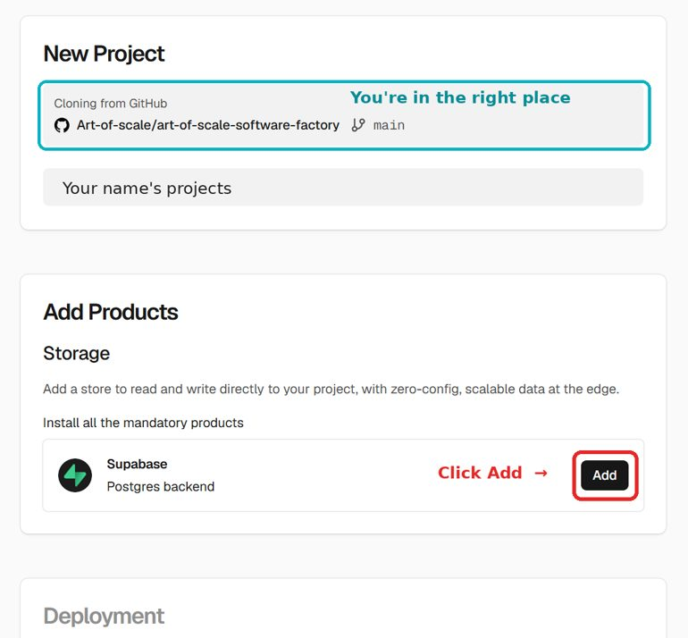

# Art of Scale Software Factory

## Start here: click the big button

**Use your everyday browser** (Chrome, Edge or Safari), the one where you signed in to GitHub and Vercel. Not the browser inside the Claude app: it does not know your logins. Right-click the button → **Copy link** → paste it into your everyday browser's address bar.

You do not need anything else on this page. The list of files above is your factory's code: you never have to read it.

### What you will see (about 10 minutes)
Vercel says **"New Project"**. That is normal: Vercel calls every app a project. This project is your first app **with** your software factory inside it (the Coach, the rules and the checks). Each later app gets its own copy, with one click.

1. **Sign in to Vercel with GitHub** if it asks. Vercel says you already have an account with this email? Sign in the way you did before (for example Google), open https://vercel.com/account/authentication, connect **GitHub**, and click the button again.
   - **You see "404 Not Found" or "Select Team"?** Normal on a first sign-in: Vercel lost the address while you signed in. Paste the same link again: the second time works.
   - **"Authorize Vercel" greyed out?** Wait 5 seconds; it turns on.
2. **You are in the right place** when you see **New Project** and **Cloning from GitHub · Art-of-scale/art-of-scale-software-factory** (picture above).
   - If you also see a **Create Git Repository** box: choose **GitHub**, keep the name `my-software-factory`, tick **Create private repository**, click **Create**. No such box? Go on. **Git Scope empty?** Click **Add GitHub Scope** → **Install** → **All repositories** (you can narrow it later at https://github.com/settings/installations).
3. Under **Add Products → Supabase**, click **Add**. In the window that opens, choose the **Free** plan, keep the suggested region and click **Create** (the words may differ slightly; no card is needed).
4. Click **Deploy**. After about a minute you see a success screen. Click **Continue to Dashboard** → **Visit**: the status board shows Code, Hosting, Database and Coach.
5. Open **claude.ai/code** in your browser (it always runs in the cloud; nothing runs on your computer) → **Connect GitHub**. This takes two steps: **Authorise** the Claude GitHub App, then **Install** it. On the install screen choose **Only select repositories** → `my-software-factory`. If claude.ai shows a **Fix** button instead, click it, and on the GitHub page still choose **Only select repositories** before you click Install. Then pick the repo and paste:

> Start my software factory. Read CLAUDE.md, install the factory if it is not installed yet, then run the sf-start skill and guide me step by step.

The first line back must say **"Guards: live"**.

Later, you can also use the Claude desktop app (Code tab, **cloud** environment): it adds an app preview pane and notifications.

No Supabase step in the Vercel flow? After the deploy: Vercel → your project → **Storage** (or Infrastructure → Storage) → **Connect database** → Supabase → Create. Then redeploy.

Repo not visible in Claude Code? github.com/settings/installations → Claude → Configure → add the repo. GitHub may ask you to confirm your email first.

## Rules
Level 3 (this kit): made-up data, or your own non-sensitive work data (Class 0, P or N). No personal or sensitive data until the Art of Scale Production-Ready Gate (Level 5). Never paste keys or passwords into chat. Only the public Supabase key goes into Vercel.

© Art of Scale. Method: spec-driven development, founder edition, built on Anthropic's AI-native SDLC playbook.
